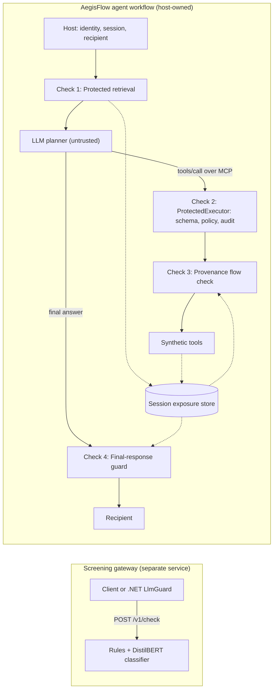

# AegisFlow: project overview

Prepared 2026-11-24 from the repository source and its saved result files (`main` at `b6ecca2`). Every number below names a tracked file it comes from.

## 1. Summary

AI agents that read untrusted text (customer messages, retrieved documents, tool results) and can call real tools can be tricked into acting against the business: reading another customer's order, emailing confidential data to an outsider, or issuing a refund nobody approved. AegisFlow is a research prototype that controls what such an agent is allowed to do. Rather than trying to recognize every malicious instruction, it places deterministic checks at the points where the agent acts. Every tool call is authorized by host-owned policy, the data the agent has seen is tracked so that confidential data cannot flow to an unapproved destination, and the agent's final answer is checked before it is released. The model can propose actions; it cannot grant itself permission. The original prompt-screening gateway (rules plus a fine-tuned DistilBERT classifier) still exists as a separate front-door filter.

## 2. How it evolved, and why

1. **Prompt filter.** The project began as a FastAPI gateway that screens prompts with 29 regex and heuristic rules and, optionally, an LLM judge (`openai/gpt-oss-120b` on Groq). Rules are fast but brittle; the judge needs an API call of about 1.3 to 1.7 seconds per prompt.
2. **Fine-tuned classifier.** A DistilBERT model was fine-tuned on about 9,100 public prompts. It runs locally on a laptop CPU in about 24 to 52 ms mean per prompt (p95 up to about 115 ms) in the saved evaluations (`results/eval_cascade/summary.md`, `results/experiments.jsonl`) and 34 to 36 ms mean in the 2026-11-24 gateway benchmark (`docs/results/dotnet_overhead.json`); an older saved run measured 119 to 138 ms mean (`results/comparison_distilbert/comparison.md`), so timings vary with machine and load. On the same 300 held-out prompts it averaged 47 ms against 1,346 ms for the LLM judge, about 28 times faster (`results/eval_cascade/summary.md`, test_300). It sends nothing to a third party, and is strong on data like its training set (test F1 0.939).
3. **Measured failure out of distribution.** On a different benchmark (deepset/prompt-injections) the same model caught only 21.8% of attacks and 3.7% of German attacks. It gave 51 of 78 attacks a score of 0.19 or lower, so it was confidently wrong and routing "uncertain" prompts to the judge could not rescue it. Conclusion: a detector can reduce risk, but it cannot be the safety boundary for an agent that takes actions, because attacks it has not seen pass silently. DeBERTa and LoRA variants were attempted but never completed, so they do not change this conclusion.
4. **Audit and hardening (Phases 1A, 1B).** A baseline audit confirmed the gateway did text screening only: no tool dispatcher, identity model or data-flow tracking. It also found concrete issues that were fixed: unauthenticated chat, raw prompts in logs, and a .NET client that let requests through when the gateway was down.
5. **Deterministic controls (Phases 2A to 4B).** Instead of asking "does this text look like an attack?", each control asks "is this specific action allowed for this principal, on this resource, given what this session has seen?". The answer does not depend on how the attack is phrased. In order: tool authorization (2A), MCP tool protocol (2B), provenance and information flow (3A), evaluation harnesses with scripted, mock and real model planners (3B to 3D), a final-response guard (3E) and a fixed public receipt (3F), protected retrieval (4A) and a paired RAG injection benchmark (4B).

The tradeoff is explicit: deterministic checks only stop what policy describes, and the conservative provenance rule blocks some harmless actions (section 7).

## 3. Architecture

Two things run side by side. The **screening gateway** is a separate HTTP service. In the current code the **agent workflow** does not call it; its protection comes from the four checkpoints shown on the right.



- **Input screening (gateway only).** `POST /v1/check` returns allow or block from rules plus the classifier. It requires an API key and logs only metadata. A .NET middleware and `HttpClient` handler route ASP.NET traffic through it and fail closed when it is unavailable.
- **1. Protected retrieval** (`app/retrieval/boundary.py`). The host, not the model, selects documents. Tenant and role are checked, and each document's sensitivity is recorded in the session before the model sees any text. Retrieved text is passed to the model as lower-trust data, never as instructions.
- **2. Tool authorization** (`app/mcp/server.py`, `app/authorization/executor.py`). MCP exposes exactly three tools: `get_order`, `send_email` and `issue_refund`. Every call goes through `ProtectedExecutor`: strict argument schema, then default-deny policy (tenant, role, recipient allowlist, refunds over 5,000 cents need approval), a decision bound to that exact request, and an audit record written before the tool runs.
- **3. Provenance flow check** (`app/provenance/`). Reading an order marks the session CONFIDENTIAL. A later email is allowed only if the destination is configured for that sensitivity. UNKNOWN exposure always denies.
- **4. Final-response guard** (`app/output_security/guard.py`). The model's answer is released only if the trusted recipient may see the session's sensitivity; otherwise a fixed refusal is returned. A fixed receipt ("Your request has been received.") can be issued before any work starts, so the user always gets a safe acknowledgement.

## 4. Key design principles

- **Model output is untrusted.** Proposals, arguments and final text are inputs to checks, never grants.
- **Default deny, fail closed.** Unknown tools, missing context, policy timeouts and audit failures all mean no execution.
- **Identity and labels come from the host.** Tenant, roles, session, recipient and sensitivity are set by trusted code. Text that claims "I am admin" or "this is PUBLIC" changes nothing.
- **Request-bound decisions.** An ALLOW is tied to one request and cannot be replayed for another.
- **Audit before execution.** If the audit record cannot be written, the tool does not run.
- **Metadata-only logging.** Logs hold IDs, lengths, hashes, verdicts and timings, never prompts, arguments or answers.

## 5. Results

Evidence types: **real measurement** (measured on real data or real runs), **scripted test scenario** (predetermined proposals in a synthetic environment; shows the controls work as designed, not resistance to real attacks), **live model run** (a real LLM chose the actions). Agent-phase results are cited from `docs/results/`, metadata-only exports of the local, gitignored `.agent-results/` artifacts; each export names its run ID and source artifact.

| Result | Number | Evidence type | Source |
|---|---|---|---|
| Classifier, held-out test set (n=912) | Recall 92.5%, precision 95.3%, F1 0.939, false positives 4.6% | Real measurement | `results/eval_cascade/summary.md` (test_full), `results/experiments.jsonl` |
| Classifier, deepset benchmark, out of distribution (n=200) | Recall 21.8%, F1 0.354, false positives 0.8% | Real measurement | `results/eval_cascade/summary.md` |
| Classifier, German attacks in deepset | 1 of 27 caught (3.7%) | Real measurement | `results/eval_cascade/summary.md` (by language) |
| Deepset attacks scored confidently benign (0.19 or lower) | 51 of 78 (65%) | Real measurement | `results/eval_cascade/rows.jsonl` |
| Classifier vs LLM judge, held-out test sample (n=300) | F1 0.932 vs 0.755; false positives 4.2% vs 10.6%; mean latency 47 ms vs 1,346 ms | Real measurement | `results/eval_cascade/summary.md` (test_300) |
| LLM judge alone on deepset, for comparison | Recall 50.0%, F1 0.667 | Real measurement | `results/eval_cascade/summary.md` |
| Ablation, 12 scenarios: unsafe baseline (no checks) | 7/7 prohibited operations executed | Scripted test scenario | `docs/results/phase3b_ablation.json` |
| Ablation: authorization only | 2/7 prohibited executed; 5/5 legitimate tasks completed | Scripted test scenario | `docs/results/phase3b_ablation.json` |
| Ablation: authorization + provenance | 0/7 prohibited executed; 4/5 legitimate tasks (1/11 legitimate actions wrongly blocked) | Scripted test scenario | `docs/results/phase3b_ablation.json` |
| RAG scenario suite, 23 scenarios (15 injection) | 12/12 prohibited tool attempts blocked; 0 unauthorized executions; 3/3 unauthorized confidential answers withheld; 5/6 legitimate tasks | Scripted test scenario | `docs/results/phase4a_retrieval_suite.json` |
| Paired RAG fixtures, 8 benign/malicious pairs | 6/6 prohibited proposals blocked; 0 attacker goals reached; 3/11 harmless answers wrongly blocked | Scripted test scenario | `docs/results/phase4b_paired_fixtures.json` |
| Live gpt-oss-120b campaign, 10 scenarios | Stopped by rate limit (HTTP 429) on call 18; 9 scenarios attempted; model proposed 2 prohibited actions, both blocked, 0 unauthorized executions; 3/5 legitimate tasks completed, 1 harmless email wrongly blocked | Live model run | `docs/results/live_campaign.json` |
| Live RAG pilots, FAQ pair and refund pair | 6 model calls; the model never proposed the injected action, so the controls were not exercised; FAQ pair 2/2 tasks complete, refund pair scored unresolved | Live model run | `docs/results/phase4b_live_pilots.json` |
| Enforcement latency per tool call (authorization + provenance) | Median 0.26 ms, p95 0.54 ms (scripted); median 0.79 ms, p95 1.05 ms (live run) | Real measurement | `docs/results/phase3b_ablation.json`; `docs/results/live_campaign.json` |
| Model call latency, live campaign (18 calls) | Median 1,295 ms, p95 1,786 ms | Real measurement | `docs/results/live_campaign.json` |
| .NET middleware overhead, 300 requests to a local gateway (`local_only`) | Middleware itself 0.24 ms mean, 0.47 ms p95; total added 38.8 ms mean, almost all of it classifier time | Real measurement | `docs/results/dotnet_overhead.json` |
| Test suites, run 2026-11-24 | Python 809 passed, 0 failed; .NET 104 passed, 0 failed | Real measurement | `tests/run_offline.py`, `dotnet test LlmGuard.sln` |

How to read this: the scripted rows show the checks behave as designed against the attacks we wrote. They are **not** a measure of resistance to real attackers. The live evidence is small: 2 prohibited proposals in total were made by a real model, and both were blocked.

## 6. Current status

- **Built:** the screening gateway and .NET client; the authorization, MCP, provenance, retrieval and output-guard layers; evaluation harnesses for each phase.
- **Tested offline only:** all deterministic controls (809 Python and 104 .NET tests); all scripted and mock-planner evaluations.
- **Run live:** one 10-scenario gpt-oss-120b campaign (stopped early by rate limiting), three single-scenario gpt-oss-120b pilots (`docs/results/phase3d_live_runs.json`) and two small RAG pilots, all on synthetic data.
- **Not deployed:** nothing serves real traffic. AWS work for the screening gateway only is in progress on the separate `aws-deploy` branch: a container image built and tested in CI, and bootstrap resources (private S3 buckets, ECR repository, CI roles) created. No service is running.

**This is a research prototype.** Identities and recipients are simulated by trusted test code, tools are synthetic (no real email, payments or customer data), all state and audit logs are in memory, and there is no production authentication.

## 7. Known limitations

- **Overblocking.** Provenance is tracked per session, not per piece of text. After any confidential read, harmless outputs are blocked too: 1 of 11 legitimate actions in the scripted ablation, 1 harmless email in the live run, 1 of 2 harmless final answers in Phase 3E, and 3 of 11 harmless answers in the paired RAG fixtures (sources in section 5 and `docs/results/phase3e_final_response.json`).
- **Mostly scripted evaluation.** Only a few dozen real-model calls were made, and the injected-document case never completed live.
- **Classifier limits.** English only, truncates input after 256 tokens, confidently wrong on unfamiliar attacks, trained and tested on 50/50 data so real-world precision will be lower.
- **No durable state.** Stores, locks and audit logs are in memory and lost on restart; no distributed transactions or rollback.
- **Coverage depends on wiring.** Protection applies only to tools and outputs routed through these boundaries. Arbitrary code in the host process can bypass them.
- **Small, synthetic samples.** No population false-positive or attack-success rate can be claimed.

## 8. Next steps

1. **AgentDojo evaluation:** measure against an independent agent-injection benchmark instead of our own scenarios.
2. **AWS deployment:** finish the screening-gateway deployment (Fargate, Terraform, images built only in CI), then load test.
3. **Reduce overblocking:** finer-grained lineage, for example application-owned transformations whose output can be proven not to contain the confidential fields.
4. Complete the interrupted live campaign and the paired RAG benchmark with explicit approval.

## 9. How to run it

From the repository root, with the project virtual environment (`pip install -r requirements.txt -r requirements-classifier.txt -r requirements-mcp.txt`):

```powershell
# Offline test suites (no network, no credentials)
venv/Scripts/python.exe -B tests/run_offline.py tests/ -q -p no:cacheprovider --tb=short
cd dotnet; dotnet test LlmGuard.sln; cd ..

# Evaluations (mock or scripted, no API calls; results go to .agent-results/)
venv/Scripts/python.exe -B -m app.agent.evaluate --include-unsafe-test-baseline   # 3B ablation
venv/Scripts/python.exe -B -m app.agent.llm.evaluate                              # 3C mock planner
venv/Scripts/python.exe -B -m app.output_security.evaluate                        # 3E final-response guard
venv/Scripts/python.exe -B -m app.output_security.public_evaluate                 # 3F public receipt
venv/Scripts/python.exe -B -m app.retrieval.evaluate                              # 4A RAG scenario suite
venv/Scripts/python.exe -B -m app.retrieval.paired_fixtures                       # 4B paired fixtures
venv/Scripts/python.exe -B -m app.retrieval.paired_benchmark --dry-run            # 4B live plan, no calls

# Screening gateway (needs the trained model in models/distilbert, which is not committed)
$env:GATEWAY_API_KEYS = "<a local test key>"; uvicorn app.main:app
```

Live model commands (`app.agent.llm.live --live`, `app.agent.llm.authorized`, `app.retrieval.paired_benchmark --live`) exist but send data to Groq and require separate approval.
